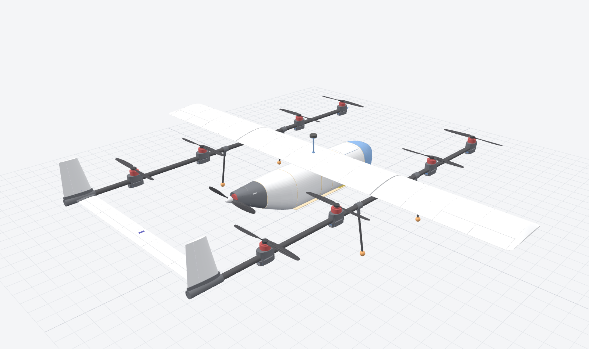
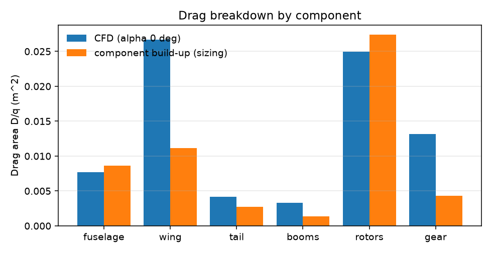

# E8-S: lift + cruise eVTOL demonstrator

A buildable, analysed subscale demonstrator of the two-seat E8 eVTOL concept, redesigned as a **lift + cruise** aircraft
with eight fixed lift rotors and a **rear pusher propeller** for speed. Every part is designed to be made with a
**3-axis CNC and FDM 3-D printers** (no metal printing) or bought off the shelf, and the whole aircraft is checked with
open-source CFD (OpenFOAM) and FEA (CalculiX).

**[Open the 3-D build viewer](https://rpirayesh.github.io/E8-eVTOL-Build/)** — every component in 3-D, how it is made, its settings and download links ·
**[Analysis & validation](https://rpirayesh.github.io/E8-eVTOL-Build/analysis.html)** · **[Bill of materials](https://rpirayesh.github.io/E8-eVTOL-Build/bom.html)**



## Design at a glance

| Item | Value |
| --- | --- |
| Configuration | twin boom, high wing, H-tail; 8 fixed lift rotors (4 per boom), 1 rear pusher |
| Span / chord / wing area | 2.9 m / 0.32 m / 0.93 m² (NACA 4415) |
| Take-off mass (sized, incl. 10 % growth) | 15.87 kg (CAD-measured structure) |
| Battery | 2 x Tattu 22000 mAh 6S in series = 12S, 977 Wh |
| Lift system | 8 x T-Motor MN5008 KV170 + P18x6.1, FLAME 60A 12S ESCs |
| Pusher | T-Motor AT4130 KV230 + APC 17x10EP, FLAME 80A 12S |
| Hover power / thrust-to-weight | 1811 W / 2.07 |
| Worst single-rotor-out | 71 % of a rotor's maximum thrust on the most loaded motor |
| Cruise | 25 m/s (90 km/h), 1318 W electrical |
| Range / cruise endurance | 46.0 km / 31 min (2 min hover, 20 % reserve) |
| Top speed (pack-voltage limited) | 28.5 m/s (103 km/h) |
| Stall speed (CLmax 1.25) | 14.8 m/s |
| Components | 144 in the assembly; 87 made in-house (34 printed and 11 machined part types) |
| Estimated cost | $5,201 including charger and transmitter |

CFD drag polar of the whole aircraft: CD0 = 0.0852, Oswald e = 0.96, cruise L/D = 4.7, static margin 7 % MAC

## Aerodynamics: what the CFD changed

Full-aircraft OpenFOAM (k-omega SST, 767,979-cell half model, lift rotors stopped):
**CD0 = 0.0852**, Oswald e = 0.96, lift slope 0.081 /deg,
neutral point 164 mm behind the leading edge -> **static margin 6.8 % MAC**
at the design CG (stable; move the battery 15 mm forward for about 10 %).

| Drag area D/q (m²) | CFD | Component build-up |
| --- | --- | --- |
| wing | 0.0267 | 0.0112 |
| fuselage | 0.0077 | 0.0086 |
| tail | 0.0042 | 0.0027 |
| booms | 0.0033 | 0.0013 |
| rotors | 0.0250 | 0.0274 |
| gear | 0.0132 | 0.0043 |

The stopped lift rotors are the largest drag item in both methods and the two agree on them. The wing and landing gear
are higher in the CFD: the CFD is fully turbulent with wall functions (the 2-D transition runs show the laminar
bucket the printed wing can keep if its surface is smooth), and the bare legs and feet are bluff — faired legs are an
easy gain. Performance is therefore bracketed:

| Drag model | Cruise L/D | Cruise power | Range |
| --- | --- | --- | --- |
| Component build-up (design value) | 5.9 | 1318 W | 46.0 km |
| CFD, fully turbulent (conservative) | 4.7 | 1725 W | 35.2 km |

With the conservative drag the pusher draws 43 A at 25 m/s (60 A peak rating): cruise at
22-23 m/s if flight logs confirm the higher drag.

A finer mesh (3,178,159 cells) gives CD = 0.0806 at 0 deg (coarse 0.0862) and CL = 1.114 at 8 deg (coarse 0.858).
The flow at 8 deg stays attached and steady on the fine mesh (CL std 0.0012), so the separation seen on the baseline mesh was a resolution effect; the 6.5 % lower drag means the baseline-mesh range figures are conservative.

**Hover download** (eight actuator disks): 43 N = 28 % of thrust as an upper
bound (uniform disks load the hub; flight data of similar aircraft is typically 5-10 %). Even at the upper bound the
thrust-to-weight is 1.62 and the worst rotor-out case loads the remaining rotors to
90 % of maximum.



## What was done

1. **Started from the E8 Design Explorer concept** (two-seat, eight tilting rotors). With a pusher for cruise thrust,
   tilting rotors are unnecessary: fixed lift rotors remove eight tilt mechanisms and stop in cruise (lift + cruise).
2. **Scale decision.** A person-carrying aircraft cannot be built or validated with a 3-axis CNC and polymer printers,
   so the build package is a subscale flying demonstrator of the same layout; the two-seat aircraft is re-studied in
   [fullscale/](fullscale/FULLSCALE.md).
3. **Optimisation** ([tools/sizing.py](tools/sizing.py)): span, chord and battery are searched for maximum range at a
   required 25 m/s cruise, subject to thrust-to-weight >= 2, rotor-out allocation <= 75 % of maximum thrust, stall <= 15 m/s,
   battery C-rate and pusher current limits. Performance uses the **manufacturer bench data** of the motors and APC's
   propeller tables. The structure masses are **measured from the CAD** and fed back until mass and CG converge.
4. **CAD** ([tools/cad/parts.py](tools/cad/parts.py), build123d / OpenCascade): 68 unique parts, STEP + STL each.
5. **CFD** (OpenFOAM v2412): NACA 0012 validation against NASA TMR data and a grid study, wing/tail section polars
   with SST and transition models, full-aircraft cruise polar and hover download with rotor actuator disks.
6. **FEA** (CalculiX 2.23 + own frame solver, both verified): ten ultimate load cases on the whole airframe, spar sizing,
   modal analysis, and solid FEA of every load-bearing printed / machined part.
7. **Propellers:** BEMT checked against APC data; printed blades analysed with centrifugal stiffening.
   **Verdict: buy the propellers** — printed blades pass static strength but fail fatigue (details below).

## Structural results (ultimate = 1.5 x limit)

| Member | Max stress | Allowable | Margin | Critical case |
| --- | --- | --- | --- | --- |
| main spar | 157 MPa | 250 MPa | +0.59 | LC6 gust/manoeuvre +4 g |
| rear spar | 161 MPa | 250 MPa | +0.55 | LC9 landing 4 g, one boom |
| boom | 120 MPa | 250 MPa | +1.08 | LC9 landing 4 g, one boom |
| stab spar | 57 MPa | 250 MPa | +3.35 | LC9 landing 4 g, one boom |
| wing skin (torsion) | 0 MPa | 3 MPa | +8.74 | LC9 landing 4 g, one boom |
| Lift motor nacelle, upper (motor pedestal) (NAC-U) | 0.2 MPa | 25 MPa | +105.73 | Thrust 60 N + motor torque 1.30 N m (1.5 x bench maximum) |
| Boom saddle, upper half (SAD-U) | 6.3 MPa | 240 MPa | +37.30 | Boom shear 241 N + boom moment 61 N m (ultimate) |
| Boom rib (wing-boom load fitting) (RIB-B) | 108.8 MPa | 240 MPa | +1.21 | Bolt loads 881 / -640 N from the saddle (ultimate) |
| Boom saddle, lower cap (SAD-L) | 2.1 MPa | 25 MPa | +10.93 | Boom inertia 118 N downward + half boom moment (ultimate) |
| Landing leg socket, starboard (LG-S) | 3.5 MPa | 25 MPa | +6.22 | Landing 467 N along the leg + 25 % drag (4 g on one boom, ultimate) |
| Bulkhead 3 (main spar carry) (BH-3) | 12.4 MPa | 25 MPa | +1.02 | Fuselage contents 262 N hung from the main spar (4 g landing, ultimate) |
| Pusher firewall plate (FW) | 15.2 MPa | 240 MPa | +14.77 | Pusher thrust 112 N + torque 3.2 N m (1.5 x bench maximum) |
| Tail block, starboard (TB-S) | 1.9 MPa | 25 MPa | +12.24 | Stab 74 N + fin 35 N at 35 m/s, CL 1.0 (ultimate) |
| Spar cap (main spar) (SC-1) | 1.6 MPa | 25 MPa | +15.02 | Spar retention 196 N (negative-g case, ultimate) |

The spar search raised the main spar from 20 x 18 to **30 x 27 mm** (same stock as the booms) and the rear spar to
12 x 10 mm; the booms were upsized to 30 x 27 mm for stiffness; the wing-carry bulkheads were widened after the first
FEA showed a negative margin. First free-free airframe mode: **6.3 Hz** (boom/wing pitch) —
measure it with a tap test and set the PX4 gyro notch ([firmware/](firmware/README.md)).

## 3-D printed propellers?

| Blade material | Peak stress (7900 rpm static) | Static margin | Fatigue margin (cruise) |
| --- | --- | --- | --- |
| PA6-CF (FDM) | 23.0 MPa | +1.03 | -0.34 |
| PETG (FDM) | 24.6 MPa | +0.30 | -0.57 |
| PLA (FDM) | 23.8 MPa | +0.54 | -0.65 |
| Tough SLA resin | 23.9 MPa | +0.28 | -0.54 |
| Carbon/nylon moulded (reference) | 26.8 MPa | +3.48 | +0.09 |

A printed PA6-CF copy of the 17x10 pusher will not break on spin-up, but its fatigue margin is negative for the cruise
duty; it is acceptable only for **ground and bench tests up to 6200 rpm**
behind a guard. Printed lift rotors also fail the fatigue check. The printable blade CAD is in
[cad/parts/PROP-PRINT](cad/parts/PROP-PRINT) for testing only.

## Repository map

| Folder | Contents |
| --- | --- |
| [docs/](docs/) | Browser viewer (GitHub Pages), analysis and BOM pages, figures, GLB models |
| [cad/parts/](cad/parts/) | STEP + STL of every manufactured part (mm) |
| [cad/assembly/](cad/assembly/) | Full assembly STEP |
| [bom/](bom/) | `BOM.csv` with prices and sources, `cut_list.csv` for carbon tubes |
| [MANUFACTURING.md](MANUFACTURING.md) | Print / CNC settings for every part |
| [ASSEMBLY.md](ASSEMBLY.md) | Build sequence, wiring, CG check, first-flight test plan |
| [VALIDATION.md](VALIDATION.md) | CFD and FEA verification and validation evidence |
| [firmware/](firmware/README.md) | PX4 control-allocation parameters |
| [fullscale/](fullscale/FULLSCALE.md) | Two-seat aircraft study with pusher |
| [analysis/](analysis/) | Raw results (JSON) of sizing, CFD, FEA and propeller studies |
| [tools/](tools/) | Everything that produced the above |

## Reproduce

```bash
python -m venv .venv && . .venv/bin/activate
pip install -r requirements.txt              # build123d, numpy, scipy, trimesh, neuralfoil, matplotlib
# OpenFOAM v2412, CalculiX and gmsh (e.g. conda-forge: openfoam=2412 calculix gmsh)
python tools/sizing.py                       # optimisation
python tools/build_cad.py                    # CAD, STEP/STL/GLB, mass properties
python tools/fea/validation.py               # solver verification
python tools/fea/airframe.py                 # global structure, modes
python tools/fea/parts_fea.py                # CalculiX part models
python tools/cfd/airfoil2d.py validate       # NACA 0012 vs NASA TMR
python tools/cfd/airfoil2d.py wing           # wing section polars
python tools/cfd/aircraft3d.py geometry && python tools/cfd/aircraft3d.py mesh
python tools/cfd/aircraft3d.py cruise && python tools/cfd/aircraft3d.py hover && python tools/cfd/aircraft3d.py post
python tools/sizing.py --cfd                 # re-evaluate with the CFD drag
python tools/propeller/prop_study.py
python tools/build_bom.py && python tools/make_figures.py && python tools/write_docs.py
```

## Safety and limits

This is an engineering design for an unmanned demonstrator of about 16 kg. Fly it only where
permitted (e.g. FAA Part 107 in the USA: under 25 kg, registered, within line of sight), with a failsafe, away from people.
Analyses are only as good as their inputs: printed-material allowables include knock-downs but printed parts vary
with printer, filament and moisture — **proof-load the boom/wing joint, spin-test the props, measure the CG and the first
structural mode, and tether the first hovers** (see [ASSEMBLY.md](ASSEMBLY.md)).
