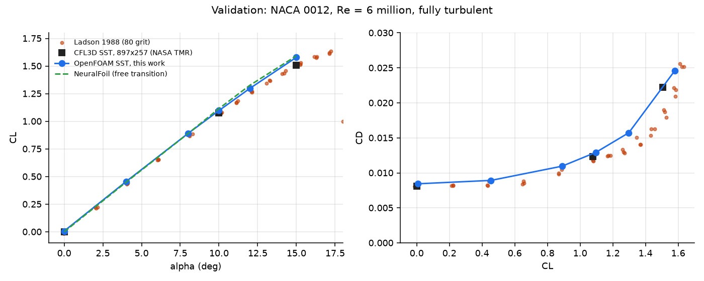
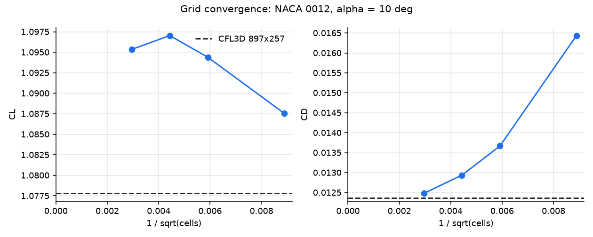
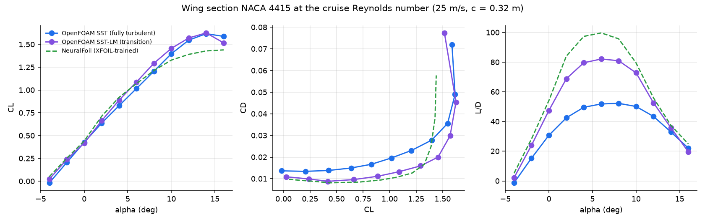
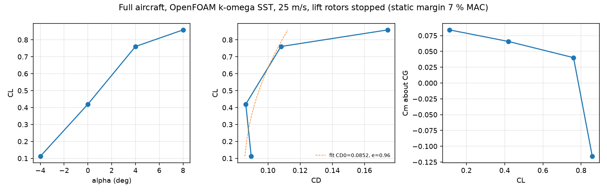
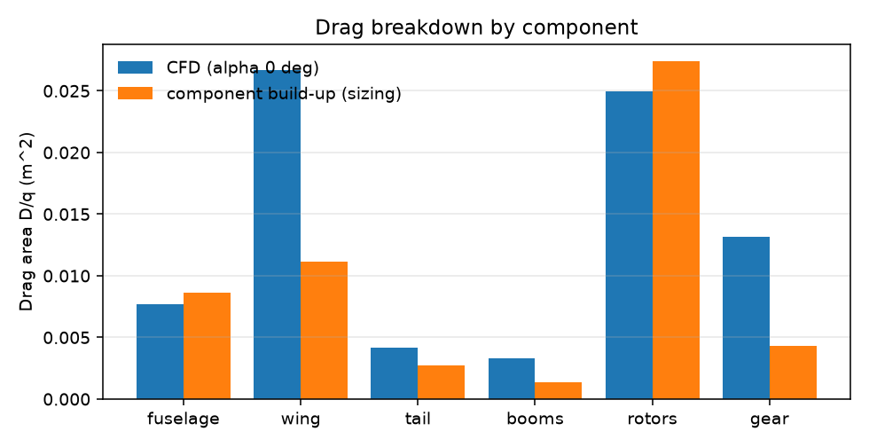
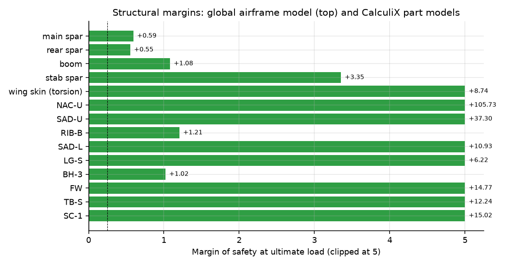
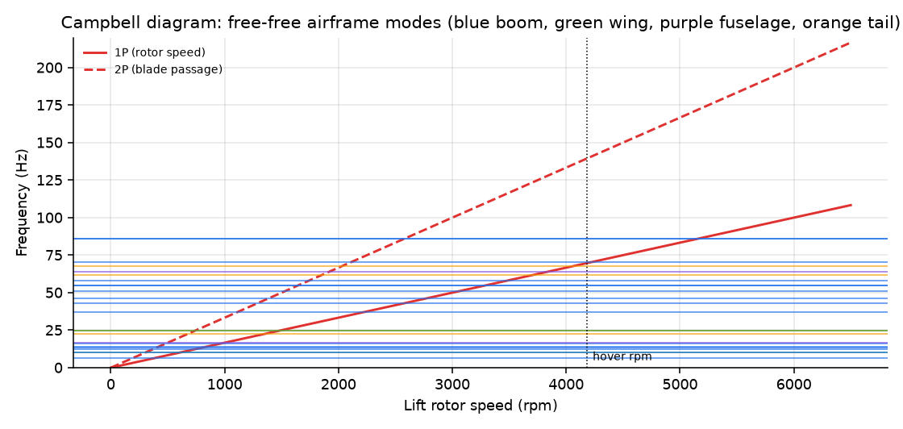
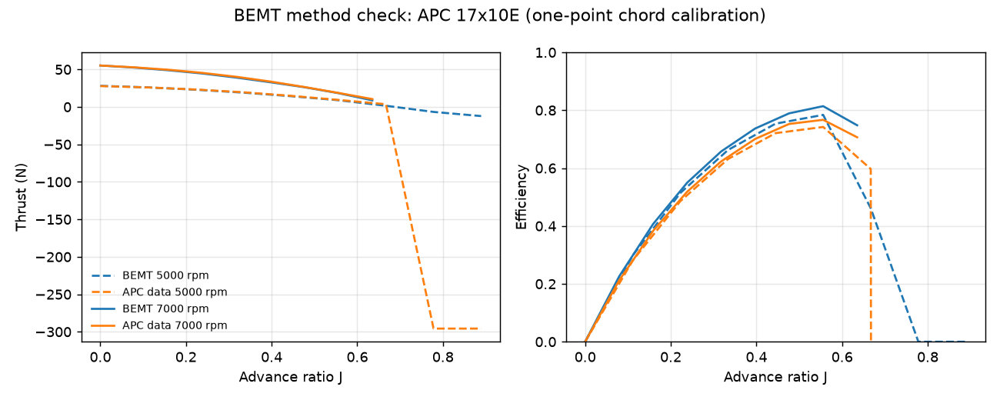

# Verification and validation

## CFD

### NACA 0012, Re = 6 million (NASA Turbulence Modeling Resource case 2DN00)

OpenFOAM `simpleFoam`, k-omega SST, structured O-grid (50880 cells, y+ < 1, far field 50 chords),
free-stream turbulence as specified by TMR (Tu 0.052 %, nu_t/nu 0.009). References: CFL3D SST on the 897 x 257 grid and
Ladson (1988) tripped experiments, both downloaded from the TMR site (`analysis/cfd/airfoil2d/reference/`).

| alpha (deg) | CL OpenFOAM | CL CFL3D | CD OpenFOAM | CD CFL3D |
| --- | --- | --- | --- | --- |
| 0 | 0.0066 | -0.0000 | 0.00844 | 0.00809 |
| 4 | 0.4548 | — | 0.00892 | — |
| 8 | 0.8899 | — | 0.01096 | — |
| 10 | 1.0970 | 1.0778 | 0.01293 | 0.01236 |
| 12 | 1.2981 | — | 0.01573 | — |
| 15 | 1.5786 | 1.5068 | 0.02457 | 0.02219 |

Lift is 2-5 % high, the expected effect of a 50-chord far field without the point-vortex correction used by TMR (500 chords).

### Grid convergence (alpha 10 deg)

| Grid | Cells | CL | CD |
| --- | --- | --- | --- |
| coarse | 12640 | 1.0875 | 0.01644 |
| medium | 28560 | 1.0944 | 0.01367 |
| fine | 50880 | 1.0970 | 0.01293 |
| extra-fine | 114720 | 1.0954 | 0.01248 |

### Wing section NACA 4415 at the cruise Reynolds number

Fully turbulent SST, Langtry-Menter transition (`kOmegaSSTLM`) and NeuralFoil (an XFOIL-trained model) are compared;
the transition model and NeuralFoil agree on the low drag bucket, the fully turbulent model is the conservative bound.

### Full aircraft

Cruise polar from the 3-D half-model (see analysis/cfd/cruise3d/results.json); mesh 767979 cells. CD0 = 0.0852, lift slope 0.0811 /deg, neutral point at x = 164 mm (CG 142 mm), static margin 7 % MAC.

Mesh sensitivity (same case set-up, one more refinement level on all aircraft surfaces):

| Mesh | Cells | CD at 0 deg | CL at 0 deg | CL at 8 deg | CD at 8 deg |
| --- | --- | --- | --- | --- | --- |
| baseline | 767,979 | 0.0862 | 0.420 | 0.858 | 0.1744 |
| fine | 3,178,159 | 0.0806 | 0.396 | 1.114 | 0.1381 |

The fine mesh lowers CD at 0 deg by 6.5 % and keeps the 8 deg flow attached (CL +30 %); the baseline-mesh polar is kept for sizing as the conservative choice, with its 8 deg point excluded from the fits.

## FEA

### V1: CalculiX C3D10 cantilever vs Timoshenko beam (mesh convergence)

| h max (mm) | Elements | Tip (mm) | Error tip | Mid-span stress (MPa) | Error stress |
| --- | --- | --- | --- | --- | --- |
| 5.0 | 2032 | 2.3032 | -1.02 % | 29.94 | -0.19 % |
| 3.0 | 8202 | 2.3064 | -0.88 % | 30.00 | +0.01 % |
| 2.0 | 24749 | 2.3072 | -0.84 % | 30.01 | +0.04 % |
| 1.25 | 97063 | 2.3078 | -0.82 % | 30.03 | +0.10 % |

Exact solution: tip 2.3268 mm (Timoshenko), mid-span stress 30.00 MPa.
Reaction force equals the applied 100 N to machine precision in every run.

### V2: frame solver vs closed form

Tip deflection 17.413 mm (exact 17.413), root stress 54.85 MPa
(exact 54.85), first frequency with tip mass 14.430 Hz (exact 14.431 Hz).

### V3: CalculiX solid vs frame solver on the same tube

Tip deflection 0.9687 mm vs 0.9553 mm (+1.4 %, shear flexibility of the solid).

### Load cases, margins and modes

Allowables (ultimate): carbon tube 250 MPa; 6061-T6 240 MPa; printed PA6-CF 25 MPa; PETG 14 MPa; birch plywood 25 MPa;
LW-PLA skin shear 3 MPa. Printed-part allowables include knock-downs for layer adhesion, moisture, creep and fatigue.

## Propeller method check

