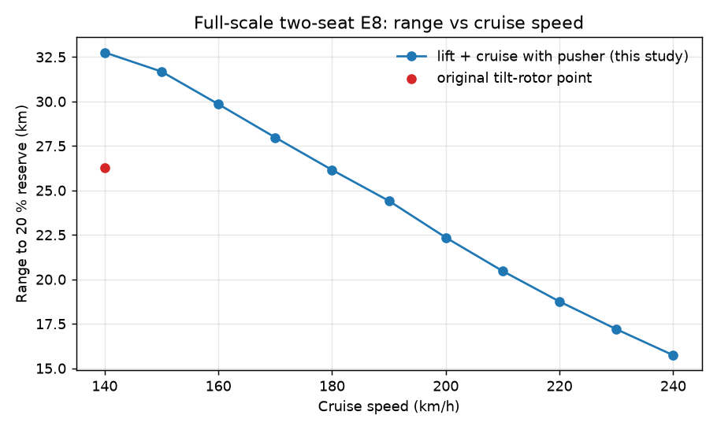

# Full-scale two-seat E8 with a rear pusher (engineering study)

Not a build package: a person-carrying aircraft needs certified structures, systems and testing far beyond this
repository. This study answers *what the pusher changes* for the two-seat aircraft, using the assumptions of the
original E8 concept study.

Changes from the original: lift rotors fixed (eight tilt mechanisms, 32 kg, removed); a pusher (motor sized to 1.25 x
cruise power at 5 kW/kg, 1.8 m propeller) provides cruise thrust; the stopped lift rotors' drag is scaled from the
subscale CFD (0.379 m², subscale component build-up, scaled by length^2).

|  | Original (tilt rotor) | Lift + cruise with pusher |
| --- | --- | --- |
| Cruise speed | 140 km/h | 180 km/h |
| Mass | 1054.8 kg | 1065 kg |
| Wing area / span | 12.0 m² / 9.0 m | 9.0 m² / 11.0 m |
| Hover / cruise electrical | 210.6 / 86.4 kW | 250 / 122 kW |
| Battery | 46.08 kWh | 46.1 kWh |
| Range (20 % reserve) | 26.27 km | 26.2 km |

Range against required cruise speed (each point re-optimised):

| km/h | range km | S m² | b m | mass kg | cruise kW | L/D |
| --- | --- | --- | --- | --- | --- | --- |
| 140 | 32.8 | 14.0 | 11.0 | 1083 | 75 | 7.5 |
| 150 | 31.7 | 12.0 | 11.0 | 1073 | 83 | 7.1 |
| 160 | 29.8 | 11.0 | 11.0 | 1070 | 95 | 6.6 |
| 170 | 28.0 | 10.0 | 11.0 | 1067 | 108 | 6.2 |
| 180 | 26.2 | 9.0 | 11.0 | 1065 | 122 | 5.7 |
| 190 | 24.4 | 8.0 | 11.0 | 1063 | 138 | 5.3 |
| 200 | 22.4 | 8.0 | 11.0 | 1069 | 158 | 4.9 |
| 210 | 20.5 | 8.0 | 11.0 | 1076 | 180 | 4.6 |
| 220 | 18.8 | 8.0 | 11.0 | 1083 | 205 | 4.2 |
| 230 | 17.2 | 8.0 | 11.0 | 1091 | 231 | 3.9 |
| 240 | 15.7 | 8.0 | 10.5 | 1099 | 262 | 3.7 |

**Findings.** At the original 140 km/h the pusher configuration flies about 25 % farther; at 180 km/h it matches the
original range while flying 29 % faster. The binding limit is the lift system: hover needs about
28.6 kW per motor (30 kW continuous rating) and the worst single-rotor-out case needs about
51 kW shaft on the most loaded motor — larger lift motors (or more rotors) are
the first change the full-scale aircraft needs, before any further aerodynamic refinement.
